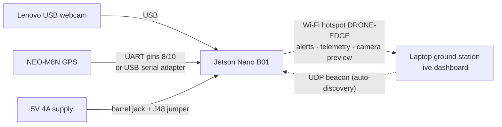

# Jetson Nano bring-up guide

How to get the pipeline running on our hardware, step by step. For the project overview and change log, see [PROJECT_STATUS.md](PROJECT_STATUS.md).

## Our hardware

| Part | What it is | How the code uses it |
|---|---|---|
| **Jetson Nano Developer Kit B01** (P3450, 4 GB) | the edge computer, in a printed case with a fan and Wi-Fi antenna | runs everything, in Docker (JetPack 4.6) |
| **Lenovo USB webcam** (FHD, with privacy shutter) | camera | `EDGE_SOURCE=0` → `/dev/video0`, asked for MJPG at 1280×720 |
| **u-blox NEO-M8N GPS module with compass** | position for alerts | `EDGE_GPS=nmea`, reads NMEA sentences over serial. The compass is not used. |
| GPS cables (6-pin GPS, 4-pin compass) | connect the GPS module | only the GPS lines are needed: VCC, GND, TX, RX |
| Mains power lead | for the power supply | the Nano needs **5 V / 4 A on the barrel jack** for full performance |

Open the **privacy shutter** on the webcam (the slider next to the lens), or you will get black frames.



---

## 1. Power

- Use a **5 V ⎓ 4 A barrel-jack supply** (5.5 × 2.1 mm, centre positive) and **fit the J48 jumper** (next to the barrel jack). Without the jumper the board ignores the barrel jack.
- Micro-USB (5 V 2 A) can boot the board, but it browns out and resets when YOLO runs in MAXN mode.
- Check the label on your power brick says 5 V and at least 4 A before plugging it in. A 12 V brick will destroy the board.

## 2. Wiring the NEO-M8N GPS

Pick **one** of these two options.

### Option A (easiest, safest): USB-serial adapter

GPS → 3.3 V USB-serial adapter (CP2102, FTDI or CH340) → any Nano USB port. It appears as `/dev/ttyUSB0`.

| GPS wire | Adapter pin |
|---|---|
| VCC | 5V |
| GND | GND |
| TX | RX |
| RX | TX |

Run with `EDGE_GPS=nmea EDGE_GPS_PORT=/dev/ttyUSB0`.

### Option B: Nano UART on the 40-pin header (`/dev/ttyTHS1`)

| GPS wire | Nano 40-pin header |
|---|---|
| VCC | **pin 2 or 4** (5 V) |
| GND | **pin 6** (GND) |
| TX | **pin 10** (UART RX) |
| RX | **pin 8** (UART TX) |

The header pin numbers are printed on the board next to the pins. Pin 1 is 3V3 and pin 2 is 5V. Odd and even pins are in separate rows.

> ⚠️ **Check the wire order before connecting.** M8N cable colours and order differ between sellers. Find VCC, GND, TX and RX from the labels on the module PCB or with a multimeter. The Nano UART pins are **3.3 V only**: never put 5 V on pin 8 or 10. The fan in our case already uses some 5 V / GND header pins, so pick free ones.

Free the UART from the Linux serial console once:

```bash
sudo systemctl disable --now nvgetty
sudo usermod -aG dialout $USER     # log out and back in
```

### Test the GPS

Take it **outdoors or next to a window**. The first fix takes 30 s to a few minutes from cold.

```bash
EDGE_GPS=nmea EDGE_GPS_PORT=/dev/ttyTHS1 jetson/run_docker.sh python3 gps_source.py
```

Expected output: `no fix  sats=3 ...` at first, then `12.97xxxx, 77.59xxxx  sats=9 hdop=0.9`.

- The baud rate is detected automatically (9600, 38400, 115200, 57600). The factory default is 9600.
- If you see `no NMEA data`, check that TX and RX are crossed, that the module is powered (its LED should be on), and that `nvgetty` is disabled.
- If the fix stays at `no fix` with `sentences` going up, the wiring is fine: it just needs a better view of the sky.

## 3. Webcam

```bash
ls /dev/video*                                   # expect /dev/video0
v4l2-ctl --list-formats-ext -d /dev/video0       # sudo apt install v4l-utils
```

If MJPG 1280×720 is listed, the default settings in `config.py` (`USB_CAPTURE_*`) work. The pipeline prints the mode it actually got, e.g. `[camera] usb 1280x720 @ 30 fps`.

To grab one frame as a quick check:

```bash
jetson/run_docker.sh python3 -c "import cv2; c=cv2.VideoCapture(0); print(c.read()[0]); cv2.imwrite('data/cam_test.jpg', c.read()[1])"
```

## 4. One-time software setup

On the Nano:

```bash
git clone https://github.com/Hisana-07/Edge_Disasted_Detection_Project.git
cd Edge_Disasted_Detection_Project
git checkout temp-jetson-fixes
jetson/setup_nano.sh
```

`setup_nano.sh` sets MAXN power mode, checks Docker and the NVIDIA runtime, adds 4 GB of swap if needed (TensorRT export needs it), builds the `edge-drone` image (Ultralytics, Flask, pyserial), and reports on the camera, the UART and any missing files.

Copy the files that are not in git from the laptop:

```bash
scp weights/yolov8n.pt weights/fire_smoke.pt <user>@<nano-ip>:~/Edge_Disasted_Detection_Project/weights/
scp data/mixed_test.mp4 data/mixed_test_labels.json <user>@<nano-ip>:~/Edge_Disasted_Detection_Project/data/
```

## 5. Bring-up order

Run each step from the repo folder on the Nano. `jetson/run_docker.sh` runs the command inside the container and passes your `EDGE_*` variables through.

| # | Command | What a pass looks like |
|---|---|---|
| 1 | `EDGE_DEVICE=0 jetson/run_docker.sh python3 check_fire_model.py data/mixed_test.mp4` | prints `classes: {0: 'fire', 1: 'smoke'}` and detections |
| 2 | `jetson/run_docker.sh python3 power_monitor.py` | `power source: sysfs:POM_5V_IN`, idle around 1500–2500 mW |
| 3 | `EDGE_DEVICE=0 jetson/run_docker.sh python3 benchmark.py --tag nano_pytorch` | writes `data/benchmark_nano_pytorch.json` with energy numbers |
| 4 | `jetson/run_docker.sh python3 export_trt.py` | writes `weights/*.engine` (several minutes per model) |
| 5 | `EDGE_DEVICE=0 EDGE_PERSON_WEIGHTS=weights/yolov8n.engine EDGE_FIRE_WEIGHTS=weights/fire_smoke.engine jetson/run_docker.sh python3 benchmark.py --tag nano_trt` | `data/benchmark_nano_trt.json`, much faster than step 3 |
| 6 | GPS test from section 2 | a fix |
| 7 | Live run (below) | alerts appear on the laptop map |

**If step 1 fails** with an error about an unknown module or layer, the container's Ultralytics is too old for YOLO26. Rebuild the image with a newer one (this leaves the CUDA-enabled torch alone):

```bash
sudo docker build --build-arg UPGRADE_ULTRALYTICS=1 -t edge-drone jetson/
```

If that still fails, export to ONNX on the laptop (`python export_onnx.py`) and use `EDGE_FIRE_WEIGHTS=weights/fire_smoke.onnx` on the board. This runs through onnxruntime, which is slower than TensorRT.

## 6. Field network: the Nano's own Wi-Fi hotspot

In the field there is no router. The Nano's Wi-Fi card becomes the access point, and the laptop joins it. Set this up once on the Nano:

```bash
sudo jetson/hotspot.sh                      # SSID DRONE-EDGE, prints a generated password once
sudo jetson/hotspot.sh --password 'choose-a-good-one'   # or pick your own (8+ characters)
```

- The Nano is then always at `10.42.0.1` and gives the laptop an address. The hotspot comes back on every boot.
- To use normal Wi-Fi again: `sudo jetson/hotspot.sh --off`.
- If the script says the card has no AP mode, use a phone hotspot that both devices join instead. Everything else works the same.

## 7. Live run with the ground station

**You don't need to type any IP address.** The ground station announces itself on the Wi-Fi every 2 s (UDP port 5005), and the drone connects to whichever station it hears (`EDGE_SERVER_URL=auto`, the default).

1. **Laptop:** join the `DRONE-EDGE` Wi-Fi, then start the station and open the dashboard at http://localhost:5000:

   ```bash
   python ground_station/app.py
   ```

2. **Nano:**

   ```bash
   EDGE_DEVICE=0 EDGE_SOURCE=0 EDGE_GPS=nmea EDGE_GPS_PORT=/dev/ttyTHS1 \
   EDGE_PERSON_WEIGHTS=weights/yolov8n.engine EDGE_FIRE_WEIGHTS=weights/fire_smoke.engine \
   jetson/run_docker.sh python3 run_pipeline.py
   ```

3. Within about 2 s the dashboard shows **LIVE**: the drone on the map, GPS status, board status, and the camera preview. Alerts pop up with a sound.

Notes:
- **Dashboard:** acknowledge and resolve alerts, add notes, and use *Export* for CSV, GeoJSON, KML (Google Earth) and a printable report (Print → Save as PDF). *New mission* starts a fresh mission.
- **Maps offline:** the station saves every map tile it shows. Open the dashboard once at home **with internet** over the flight area, or download the area ahead of time:

  ```bash
  python ground_station/tiles.py prefetch --bbox 12.965,77.585,12.978,77.598 --zoom 14-18
  ```

- **Extra security:** set the same key on both sides, `GS_LINK_KEY=...` on the laptop and `EDGE_LINK_KEY=...` on the Nano. The station then ignores anything sent without the key.
- **Fixed address instead of discovery:** `EDGE_SERVER_URL=http://<laptop-ip>:5000`.
- **Demo without the Nano:** `python ground_station/demo_drone.py` simulates a drone flying, spotting a fire and a person. Use `--no-gps` to show the "no fix" handling.
- **Indoor test:** point the webcam at a fire video on a phone or monitor. If an alert shows `no fix`, the GPS had no valid position at that moment; the alert is still stored and sent.
- **Stopping:** Ctrl+C (or `systemctl stop`) stops cleanly and sends any buffered alerts. If the link drops, alerts wait on the drone and are sent when it comes back.

## 7b. Start automatically at boot (no monitor on the drone)

```bash
sudo jetson/install_service.sh
sudo nano /etc/default/edge-drone          # check the GPS port; EDGE_SERVER_URL=auto finds the laptop
sudo systemctl start edge-drone
journalctl -u edge-drone -f                # live log
```

To turn it off: `sudo systemctl disable --now edge-drone`.

## 8. Troubleshooting

| Symptom | Likely cause / fix |
|---|---|
| Board resets when YOLO starts | power supply: use 5 V 4 A barrel jack + J48 jumper |
| `Could not open source: 0` | webcam not plugged in, or not passed to the container (check `ls /dev/video*` on the host) |
| All-black frames | the webcam privacy shutter is closed |
| `no NMEA data on /dev/ttyTHS1` | TX/RX not crossed, `nvgetty` still enabled, or no power to the GPS |
| GPS `no fix` indoors | normal: go outside |
| Dashboard says WAITING FOR DRONE | the drone has not found the station. Check: laptop joined `DRONE-EDGE`; the laptop firewall allows Python on TCP 5000 (incoming) and UDP 5005; the Nano log shows `[link] ground station found at ...`. To skip discovery, set `EDGE_SERVER_URL=http://<laptop-ip>:5000`. Test with `curl http://<laptop-ip>:5000/health` from the Nano. |
| LINK LOST on the dashboard | the Wi-Fi link dropped or the pipeline stopped. Alerts are kept on the drone and arrive when the link is back. |
| Map is blank in the field | those tiles were never cached: open the area once with internet, or use `tiles.py prefetch` |
| `power source: none` | not running on the Jetson, or `/sys` not visible in the container |
| TensorRT export killed | out of memory: run `jetson/setup_nano.sh` to add swap, and close the desktop session |
| Everything is slow | run `sudo nvpmodel -m 0 && sudo jetson_clocks`. `jetson_clocks` resets at reboot; the autostart service runs it for you. |
